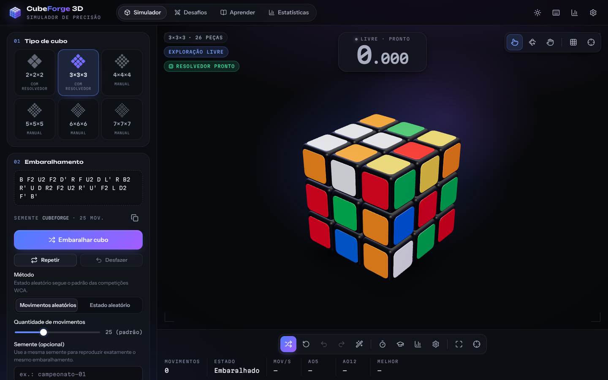
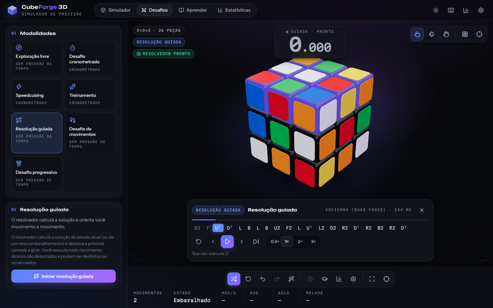
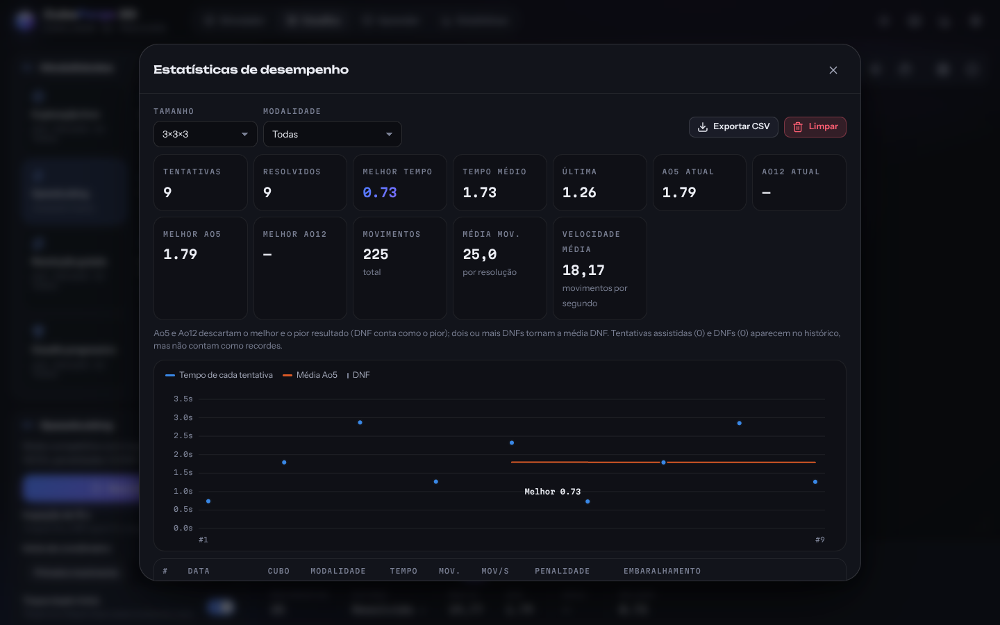
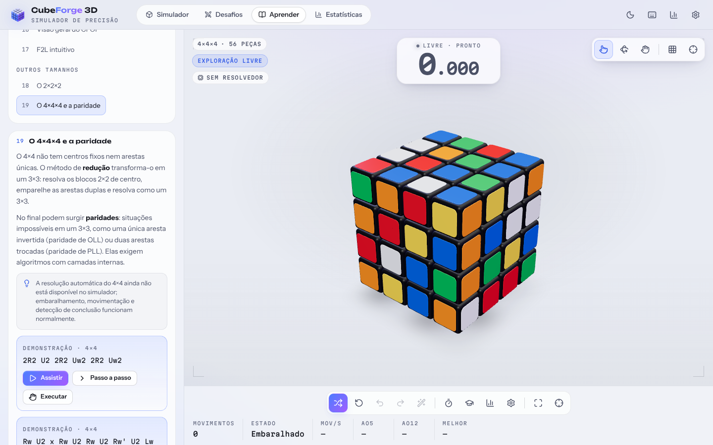
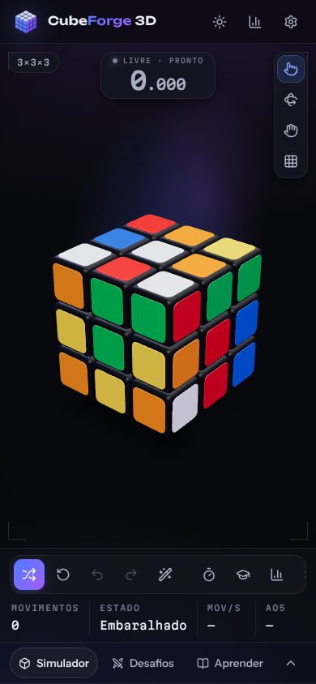

<div align="center">


# CubeForge 3D

**Simulador avançado de Cubo Mágico em 3D — do 2×2 ao 7×7, com giros reais, cronômetro de competição, resolução automática e tutoriais interativos.**

React · TypeScript · Three.js · React Three Fiber · Zustand · Vite

</div>



## Sumário

- [Sobre o projeto](#sobre-o-projeto)
- [Funcionalidades](#funcionalidades)
- [Capturas de tela](#capturas-de-tela)
- [Tecnologias](#tecnologias)
- [Instalação e execução](#instalação-e-execução)
- [Como utilizar](#como-utilizar)
- [Controles e atalhos](#controles-e-atalhos)
- [Modos de jogo](#modos-de-jogo)
- [Resolução automática](#resolução-automática)
- [Arquitetura](#arquitetura)
- [Testes](#testes)
- [Publicação (GitHub Pages)](#publicação-github-pages)
- [Limitações conhecidas](#limitações-conhecidas)
- [Melhorias futuras](#melhorias-futuras)

## Sobre o projeto

O CubeForge 3D é uma aplicação web que simula Cubos Mágicos tridimensionais com
movimentação matematicamente correta. Cada camada gira de verdade: o estado
lógico do cubo (posição e orientação de cada peça) é independente da
renderização, e o visualizador 3D apenas representa esse estado.

**Objetivo:** oferecer uma experiência completa — explorar, treinar, competir e
aprender — com a qualidade visual de um produto profissional, funcionando no
computador e no celular, sem cadastro e sem servidor.

## Funcionalidades

### Cubo e movimentação
- Cubos **2×2, 3×3, 4×4, 5×5, 6×6 e 7×7**, cada um com suas próprias regras de camadas.
- Notação completa: `R R' R2`, faces `U D L R F B`, camadas internas (`2R`, `3U`),
  movimentos largos (`Rw`, `r`, `3Rw`), fatias `M E S` (cubos ímpares) e rotações `x y z`.
- **Girar camadas arrastando** sobre o cubo (mouse ou dedo): a camada acompanha o
  gesto e encaixa no quarto de volta mais próximo; gestos rápidos contam como giro.
- Modos de interação **Automático** (arrastar no cubo gira camadas; fora dele, a
  câmera), **Câmera** e **Cubo** (câmera travada).
- Teclado de movimentos na tela, campo para digitar sequências e atalhos de teclado.
- **Fila de animação**: comandos rápidos nunca corrompem o estado; a velocidade
  da animação não altera o resultado lógico.
- Desfazer / refazer ilimitados.

### Visualização 3D
- Peças individuais com corpo arredondado, adesivos com bisel, material plástico
  (verniz, reflexos de ambiente), luzes direcional e de contorno, sombras de contato.
- Câmera orbital com zoom, enquadramento automático, posições predefinidas,
  redefinição animada e limites que impedem atravessar o cubo.
- Animação de abertura (opcional, respeita "movimento reduzido").
- Qualidade gráfica **baixa / média / alta / automática** (o modo automático
  estima o dispositivo e reduz o nível se o desempenho cair).
- Planificação 2D opcional do estado lógico; se o WebGL não estiver disponível,
  o simulador continua utilizável no modo 2D.

### Embaralhamento
- Embaralhamento por **movimentos aleatórios** sem redundâncias (nunca `R R'`,
  `R L R` etc.) para todos os tamanhos.
- Embaralhamento por **estado aleatório** (padrão WCA) para 2×2 e 3×3.
- Quantidade configurável, **semente opcional** para reproduzir, copiar sequência,
  repetir, embaralhamento animado ou instantâneo.

### Cronômetro e conclusão
- Exibição em milésimos (ou centésimos), início por **primeiro movimento**,
  **Espaço/botão** ou **toque duplo** no cubo.
- **Inspeção de 15 s** (regras WCA): avisos aos 8 s e 12 s, **+2** após 15 s e **DNF** após 17 s.
- Pausa apenas nos modos livre e de treino.
- O cronômetro só para quando o **estado lógico** está realmente resolvido — em
  qualquer orientação do cubo ou da câmera.
- Tela de conclusão com tempo, movimentos, velocidade (mov/s), recorde pessoal,
  penalidades editáveis e animação comemorativa.
- Uso de recursos de assistência (resolução automática, demonstração) marca a
  tentativa como **assistida** — ela não entra em recordes nem médias.

### Estatísticas
- Tentativas, resolvidos, melhor tempo, média, último, **Ao5** e **Ao12** (atuais e
  melhores), movimentos totais e médios, velocidade média.
- Descarte correto do melhor e do pior resultado; DNF conta como pior; dois DNFs
  tornam a média DNF.
- Gráfico de evolução (tempo de cada tentativa + Ao5), comparação por tamanho,
  histórico com edição de penalidade, exclusão e **exportação CSV**.
- Separação por tamanho e modalidade. Tudo salvo localmente (`localStorage`).

### Aprender a resolver
- 19 lições: o que é o cubo, peças e camadas, notação, movimentos duplos, fatias e
  rotações, gatilhos, **método iniciante em 7 etapas**, visão geral do **CFOP**,
  F2L intuitivo, 2×2 e paridades do 4×4.
- Demonstrações no próprio cubo 3D: **Assistir**, **Passo a passo** (avançar,
  voltar, velocidade) e **Executar** (o sistema confere cada movimento seu).
- Destaque visual de centros, arestas e cantos.

### Personalização
- Esquemas de cores e cor de cada face, acabamento (brilhante, acetinado, fosco),
  cor do corpo, reflexos, arredondamento e espaçamento das peças.
- Tema escuro, claro ou do sistema; fundo do palco; iluminação; sombras; efeitos.
- Duração e suavidade das animações; movimento reduzido.
- Sensibilidade, zoom e posição inicial da câmera.
- Sons sintetizados (giro, conclusão, avisos de inspeção) com volume ajustável.
- Painel lateral redimensionável. Preferências salvas localmente.

## Capturas de tela

| Resolução guiada | Estatísticas |
|---|---|
|  |  |

<sub>Os tempos da captura de estatísticas vêm de uma sessão automatizada usada para gerar as imagens (por isso são tão curtos); não representam resoluções humanas.</sub>

| Tema claro, 4×4 e lições | Celular |
|---|---|
|  |  |

## Tecnologias

| Área | Ferramentas |
|---|---|
| Interface | React 19, TypeScript 5.9, CSS com design tokens (temas claro/escuro) |
| 3D | Three.js 0.180, React Three Fiber 9, Drei 10 (OrbitControls, Environment, ContactShadows) |
| Estado | Zustand 5 (com persistência em `localStorage`) |
| Algoritmos | Motor próprio em TypeScript; resolvedor de Kociemba (duas fases) e resolvedor ótimo do 2×2, executados em Web Worker |
| Build | Vite 7 |
| Testes | Vitest 4, React Testing Library, Playwright 1.56 |
| Qualidade | ESLint 10 + typescript-eslint |
| Publicação | GitHub Actions + GitHub Pages |
| Tipografia | Unbounded, Instrument Sans e Martian Mono (via Fontsource, sem requisições externas) |
| Ícones | Lucide |

> Tailwind CSS não foi adotado: a identidade visual usa um conjunto pequeno de
> tokens CSS (cores, raios, sombras, tipografia), o que mantém o CSS enxuto e
> facilita os temas claro/escuro.

## Instalação e execução

Requisitos: **Node.js 20.19+** (recomendado 22) e npm.

```bash
npm install        # instala as dependências
npm run dev        # servidor de desenvolvimento em http://localhost:5173
npm run build      # build de produção em dist/
npm run preview    # serve o build de produção em http://localhost:4173
```

### Todos os comandos

| Comando | Descrição |
|---|---|
| `npm run dev` | Servidor de desenvolvimento com recarga instantânea |
| `npm run build` | Verificação de tipos + build de produção |
| `npm run preview` | Serve o conteúdo de `dist/` |
| `npm run lint` | ESLint |
| `npm run typecheck` | Verificação de tipos (TypeScript) |
| `npm run test` | Testes unitários e de integração (Vitest) |
| `npm run test:watch` | Vitest em modo observação |
| `npm run test:e2e` | Testes de ponta a ponta (Playwright, contra o build de produção) |
| `npm run check` | Lint + tipos + testes + build |

Para os testes de ponta a ponta, instale o navegador uma vez:
`npx playwright install chromium` e rode `npm run build` antes de `npm run test:e2e`.

## Como utilizar

1. **Escolha o cubo** no painel lateral (2×2 a 7×7).
2. **Embaralhe** com o botão *Embaralhar cubo* (ou tecla `N`).
3. **Gire as camadas** arrastando sobre uma face, pelos botões ou pelo teclado.
4. **Gire a câmera** arrastando fora do cubo; use a roda do mouse ou pinça para zoom.
5. Para competir, abra **Desafios**, escolha *Desafio cronometrado* ou *Speedcubing*
   e pressione `Espaço`. O tempo começa no primeiro giro e para sozinho ao resolver.
6. Precisa de ajuda? Use **Resolver automaticamente** (2×2 e 3×3) ou a seção
   **Aprender**.

## Controles e atalhos

### Mouse e toque
| Ação | Gesto |
|---|---|
| Girar uma camada | Arrastar sobre uma face (a camada segue o gesto) |
| Girar a câmera | Arrastar fora do cubo (ou em qualquer lugar no modo Câmera) |
| Zoom | Roda do mouse / pinça com dois dedos |
| Iniciar o cronômetro | Toque (ou clique) duplo na área do cubo |

### Teclado
| Tecla | Ação |
|---|---|
| `R` `L` `U` `D` `F` `B` | Gira a face no sentido horário (pressione duas vezes para 180°) |
| `Shift` + letra | Sentido anti-horário (`R'`) |
| `Alt` + letra | Movimento largo (`Rw`) |
| `2`–`9` e depois a letra | Camada interna (`2R`, `3U`…) |
| `M` `E` `S` | Fatias (cubos ímpares) |
| `X` `Y` `Z` | Rotação do cubo inteiro |
| `Espaço` | Cronômetro / inspeção / novo desafio (conforme o modo) |
| `N` | Novo embaralhamento |
| `Ctrl+Z` ou `Backspace` / `Ctrl+Y` | Desfazer / refazer |
| `Shift+Backspace` | Reiniciar o cubo |
| `C` | Redefinir a câmera |
| `T` | Estatísticas |
| `,` | Configurações |
| `[` / `]` / `P` | Reprodutor: voltar / avançar / reproduzir-pausar |
| `?` | Lista de atalhos |
| `Esc` | Fecha diálogos |

Os atalhos ficam inativos enquanto você digita em um campo de texto.

## Modos de jogo

| Modo | Descrição |
|---|---|
| **Exploração livre** | Manipulação sem regras; relógio manual que pode ser pausado. |
| **Desafio cronometrado** | Embaralha, cronometra a partir do primeiro giro e registra o tempo. |
| **Speedcubing** | Inspeção de 15 s com penalidades, médias Ao5/Ao12, tentativas abandonadas viram DNF. |
| **Treinamento** | Biblioteca de 21 algoritmos (gatilhos, método iniciante, OLL, PLL, 2×2, paridades 4×4); o caso é preparado e cada movimento é conferido; cronômetro pausável. |
| **Resolução guiada** | O resolvedor calcula a solução e destaca a próxima camada; desvios são detectados e podem ser desfeitos ou recalculados (2×2 e 3×3). |
| **Desafio de movimentos** | Resolva com o mínimo de movimentos e compare com a solução do computador. |
| **Desafio progressivo** | 14 níveis com embaralhamentos fixos e verificáveis (1 a 25 movimentos), estrelas por eficiência e desbloqueio sequencial. |

A contagem de movimentos usa a métrica de fatias (cada giro de camada, fatia ou
movimento largo conta 1, inclusive giros de 180°); rotações `x y z` não contam.

## Resolução automática

| Tamanho | Método | Garantias |
|---|---|---|
| **3×3** | Algoritmo de duas fases de **Herbert Kociemba** (tabelas de movimento e de poda, busca IDA* com melhoria iterativa) | Soluções de ~20 movimentos em centenas de milissegundos |
| **2×2** | **Busca ótima** em uma tabela de distâncias de todos os 3.674.160 estados | Sempre a solução mais curta (≤ 11 movimentos) |
| **4×4 a 7×7** | Indisponível | A interface informa claramente; ver *Limitações* |

Como funciona:

1. O estado lógico atual é convertido em facelets e normalizado pelos centros
   (3×3) ou pelo canto DBL (2×2) — funciona após rotações e fatias, sem usar o histórico.
2. A solução é calculada em um **Web Worker** (a interface não trava); as tabelas
   são preparadas em segundo plano logo após o carregamento.
3. A solução é **aplicada a uma cópia do estado** e descartada se não resolver o cubo.
4. O reprodutor mostra a sequência e permite resolver tudo, passo a passo,
   voltar, pausar, continuar e ajustar a velocidade.

O mesmo resolvedor gera os embaralhamentos por estado aleatório (o inverso da
solução de um estado sorteado uniformemente), como nas competições WCA.

## Arquitetura

```
src/
├── engine/                 # Núcleo matemático (sem dependência de renderização)
│   ├── math/               # Grupo das 24 rotações (matrizes inteiras)
│   ├── state/              # Estado N×N, aplicação de movimentos, facelets, conclusão
│   ├── moves/              # Notação (parse/format/inverso) e primitivas por camada
│   ├── scramble/           # PRNG com semente e embaralhamento sem redundância
│   ├── solver/             # Kociemba (3×3), 2×2 ótimo, Web Worker e cliente
│   └── validation/         # Validação estrutural de estados
├── cube/                   # Renderização 3D
│   ├── geometry/           # Corpo arredondado e adesivo compartilhados
│   ├── materials/          # Materiais por acabamento/cor (compartilhados)
│   ├── rendering/          # Canvas, modelo, câmera, luzes, qualidade, WebGL
│   ├── animations/         # Barramento visual (fila de giros)
│   └── interaction/        # Conversão de arrasto em giro de camada
├── features/               # Funcionalidades
│   ├── timer/  statistics/  tutorials/  challenges/
│   ├── settings/  player/  solver/  audio/
├── components/             # Layout, controles, painéis e UI reutilizável
├── store/                  # Stores Zustand e o controlador que orquestra tudo
├── hooks/  utils/  types/  styles/
└── tests/                  # Configuração dos testes
e2e/                        # Testes Playwright
```

**Separação obrigatória:** cada peça é representada por uma posição inteira e um
índice no grupo de 24 rotações. Todo movimento é uma rotação exata de 90° sobre
inteiros, por isso as peças nunca "desalinham", mesmo após milhares de giros. O
renderizador mantém sua própria cópia do estado exibido, anima um giro por vez a
partir de uma fila e, ao fim de cada giro, reposiciona as peças a partir do
estado exato. A conclusão é detectada apenas pelo estado lógico.

## Testes

```bash
npm run test       # 160 testes unitários/integração
npm run test:e2e   # 11 testes de ponta a ponta (após npm run build)
```

Cobertura principal:

- **Propriedades matemáticas** (seção 20), em todos os tamanhos 2–7: quatro giros
  de 90° = identidade; movimento + inverso = identidade; sequência + inversa
  recupera o estado; embaralhamentos estruturalmente válidos e (3×3) fisicamente
  solúveis; conclusão detectada em qualquer orientação; alinhamento após 600
  movimentos; regras específicas por tamanho.
- **Consistência com o modelo de Kociemba**: cada movimento do motor coincide com
  as tabelas de cubies.
- **Resolvedores**: 60 embaralhamentos 3×3 resolvidos e verificados, superflip,
  200 estados 2×2 em ≤ 11 movimentos, estados impossíveis rejeitados.
- **Biblioteca de algoritmos**: cada PLL/OLL/paridade preserva as camadas esperadas.
- **Controlador**: comandos rápidos, desfazer/refazer, cronômetro (início, parada
  automática, inspeção +2, início manual, pausa no treino), DNF ao abandonar,
  tentativas assistidas, reprodução da solução, resolução guiada, níveis,
  persistência de histórico e configurações.
- **Estatísticas**: Ao5/Ao12 com DNF e +2, melhores médias, tentativas assistidas.
- **E2E (Chromium, WebGL por software)**: inicialização sem erros de console,
  movimento e redefinição da câmera, giro por arrasto com mouse e por **toque**,
  teclado e comandos rápidos (estado exibido = estado lógico), desafio
  cronometrado completo com histórico persistido, resolução automática com
  passo/volta/reprodução, regras do 4×4, persistência de configurações, layout
  em celular e demonstração de lição.

**Verificação manual:** a interface foi inspecionada por capturas de tela em
Chromium sem GPU (desktop 1366–1440 px e celular 390 px). Não houve teste em
dispositivos físicos nem em Safari/Firefox.

## Publicação (GitHub Pages)

O projeto é estático e usa caminhos relativos (`base: './'`), então o mesmo
build funciona localmente e em subcaminhos como `https://<usuário>.github.io/<repositório>/`.

- `.github/workflows/ci.yml` — em pull requests e na `main`: lint, tipos, testes,
  build e testes E2E.
- `.github/workflows/deploy.yml` — a cada push na `main`, testa, gera o build e
  publica no GitHub Pages.

**Passo necessário (uma única vez, feito pelo dono do repositório):**
*Settings → Pages → Build and deployment → Source: **GitHub Actions***. Depois
disso, o próximo push na `main` (ou *Actions → Deploy no GitHub Pages → Run
workflow*) publica o site em `https://helio965.github.io/Cubo-Magico/`.

## Limitações conhecidas

- **Resolução automática do 4×4 ao 7×7 não está disponível.** Exigiria um método de
  redução (centros, pareamento de arestas, paridades) ainda não implementado e
  validado. Nesses tamanhos, embaralhamento, movimentação, cronômetro,
  estatísticas e detecção de conclusão funcionam normalmente; a resolução guiada
  e a comparação do desafio de movimentos ficam indisponíveis.
- Embaralhamento por estado aleatório apenas para 2×2 e 3×3 (os demais usam
  movimentos aleatórios).
- O giro por arrasto movimenta uma camada por vez; movimentos largos e rotações
  são feitos pelos botões ou pelo teclado.
- As tabelas do resolvedor 3×3 levam cerca de 1–3 s para serem geradas na
  primeira vez (em segundo plano, em um Web Worker).
- A inspeção segue as penalidades da WCA, mas não reproduz o protocolo do
  StackMat (segurar e soltar).
- O botão de tela cheia fica desativado em navegadores que não permitem tela
  cheia para páginas (por exemplo, Safari no iPhone).
- Os dados ficam no navegador (`localStorage`); não há sincronização entre dispositivos.

## Melhorias futuras

- Resolvedor por redução para 4×4 e cubos maiores.
- Mais casos de OLL/PLL/F2L e treinadores dedicados por conjunto de algoritmos.
- Médias Ao50/Ao100, sessões nomeadas e importação de dados.
- Instalação como PWA e funcionamento offline.
- Suporte a cubos inteligentes via Bluetooth.
- Outras modalidades (Pyraminx, Skewb, Megaminx).
- Internacionalização (inglês e espanhol).

## Licença

Distribuído sob a licença MIT. Veja [LICENSE](LICENSE).
